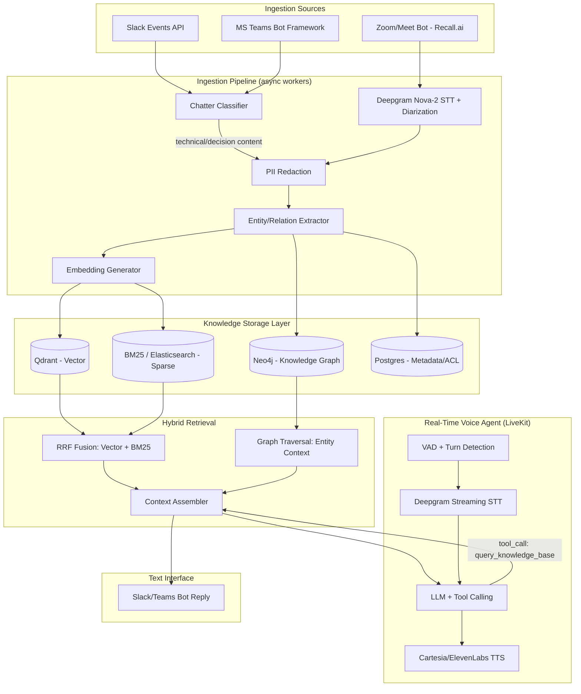

# Architecture — Enterprise Omnichannel AI Knowledge & Voice Agent

## 1. Design corrections vs. the original spec

- **RRF is not "vector + graph."** RRF fuses multiple *ranked lists over comparable results* (dense vector hits + BM25/sparse hits). Graph traversal produces entities and relationship paths, not a ranked document list — it cannot be RRF'd against vector results without inventing a fake scoring function. The correct pattern:
  1. Vector search (dense) and BM25 (sparse) both run against the same chunk corpus → fused with RRF → ranked chunk list.
  2. Named entities are extracted from the query → graph traversal (Neo4j) pulls related entities/edges (e.g., `Project -[HAS_ISSUE]-> Issue -[RESOLVED_BY]-> DeployScript`) → this becomes **structured context**, injected into the prompt alongside the RRF'd chunks, not merged into the same ranked list.
- **Ingestion vs. voice-agent are different runtimes.** Passive Slack/Teams/Meet ingestion is a batch/streaming background service. The LiveKit voice agent is a low-latency foreground process. They share the storage layer, not a process.
- **Retrieval is tool-gated, not every-turn.** To hit sub-second voice latency, the LLM only calls the `query_knowledge_base` tool when the user's utterance has query intent (a question, a request for a decision/log/doc). Casual conversation turns skip retrieval entirely.

## 2. High-level architecture

## 3. Data flow — passive ingestion

1. Slack `message.channels` / `app_mention` event → webhook → queue (e.g., SQS/Redis Streams).
2. Worker pulls message → `ChatterClassifier` (lightweight LLM or fine-tuned classifier) scores it: `{technical_decision, debug_log, schedule, doc_reference, casual}`. Only non-casual classes proceed.
3. `PIIRedactor` strips emails, phone numbers, secrets/tokens, credit-card-like patterns before anything is persisted.
4. `EntityExtractor` (LLM-based NER) pulls `(entity, relation, entity)` triples → written to Neo4j.
5. `EmbeddingGenerator` chunks + embeds text → written to Qdrant (dense) and indexed in BM25 store (sparse) with shared `chunk_id`.
6. Metadata row (`workspace_id`, `channel_id`, `source`, `acl_scope`, `timestamp`) written to Postgres — this is the access-control join table used at query time.

For Zoom/Meet: Recall.ai bot joins the call → streams audio to Deepgram Nova-2 (speaker diarization + timestamps) → transcript segments flow through the **same** classifier → PII → NER → embedding pipeline as Slack text, tagged `source=meeting`.

## 4. Data flow — real-time voice query

1. LiveKit room audio → Deepgram streaming STT → transcript segment.
2. Turn detection (VAD + endpointing) decides the user has finished a turn.
3. Transcript sent to LLM with tool definitions. LLM decides: does this need a KB lookup?
   - No → respond directly (fast path, no retrieval).
   - Yes → call `query_knowledge_base(query, workspace_id, channel_scope)` tool.
4. Tool executes: RRF(vector, BM25) + Neo4j graph traversal on extracted entities → assembled context (capped token budget) → returned to LLM.
5. LLM generates response with citations (source channel/doc/timestamp) → streamed to Cartesia/ElevenLabs TTS → audio back to LiveKit room.
6. Barge-in: if user speech is detected while TTS is playing, LiveKit's interruption handling cancels the current TTS stream immediately.

## 5. Latency budget (realistic, not the original 800ms claim)

| Stage | Target | Notes |
|---|---|---|
| STT (partial→final) | 150–300ms | Deepgram streaming, interim results used for turn detection |
| Turn detection / endpointing | 100–300ms | Silence threshold or semantic endpointing |
| LLM first token (no tool call) | 200–400ms | Fast path |
| LLM first token (with tool call) | 600–1200ms | Retrieval round-trip dominates |
| TTS first audio byte | 150–300ms | Streaming TTS |

**Sub-800ms end-to-end is realistic only on the no-retrieval fast path.** Knowledge-lookup turns will commonly exceed 1s. Document this to stakeholders — don't commit to 800ms for every turn.

## 6. Security & governance model

See `security/governance.md` for full detail. Summary:
- **Workspace scoping**: every stored chunk/entity carries `workspace_id`; every query is filtered by the caller's workspace before retrieval, not after.
- **Channel ACL**: Postgres `channel_acl` table mirrors Slack/Teams channel membership; retrieval joins against it so a user can never retrieve content from a channel they're not in.
- **PII redaction**: regex + NER-based redaction pass before persistence, not at query time — unredacted text never touches the vector/graph store.
- **Voice consent**: meeting bot announces itself on join (`"AI Knowledge Agent joined and is recording for knowledge capture"`); recording stops if a participant objects (configurable per-workspace policy).
